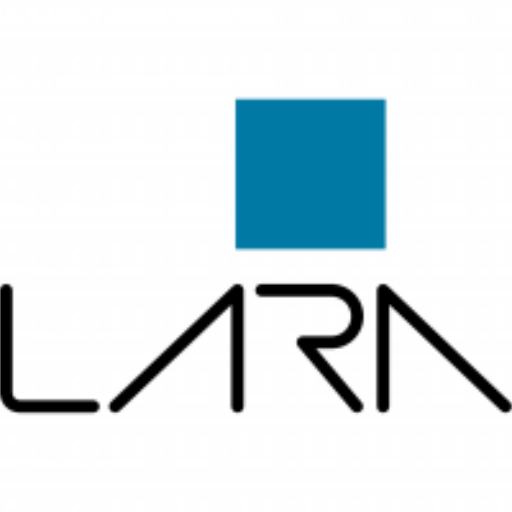

---
hide:
  - navigation
  - toc
---

# Kit IMU Yost Labs

Laboratório de Automação e Robótica · Universidade de Brasília

Documentação do kit de IMUs 3-Space (Yost Labs) do LARA, do software do fabricante à integração da IMU com o estimulador.

[Começar pelo nível iniciante](iniciante/index.md){ .md-button .md-button--primary }
[Referência](referencia/index.md){ .md-button }

## Níveis

-   :material-numeric-1-circle:{ .lg } **Iniciante**

    ---

    Instalação do 3-Space Sensor Suite, conexão das IMUs e primeira coleta, sem programação.

    [:octicons-arrow-right-24: Iniciante](iniciante/index.md)

-   :material-numeric-2-circle:{ .lg } **Intermediário**

    ---

    Leitura de uma e de duas IMUs com Python.

    [:octicons-arrow-right-24: Intermediário](intermediario/index.md)

-   :material-numeric-3-circle:{ .lg } **Avançado**

    ---

    Várias IMUs, ROS e a IMU integrada ao estimulador (FES).

    [:octicons-arrow-right-24: Avançado](avancado/index.md)

-   :material-book-open-variant:{ .lg } **Referência**

    ---

    Manuais, APIs, firmwares e instaladores do fabricante.

    [:octicons-arrow-right-24: Referência](referencia/index.md)

## Organização

Cada nível reúne guias passo a passo, os pré-requisitos e os repositórios do laboratório que servem de base. O material de consulta fica em [Referência](referencia/index.md). A divisão em níveis segue o modelo do [Hasomed-training](https://github.com/lara-unb/Hasomed-training).

## O kit

O kit tem dois dongles, Wi-Fi e Bluetooth, e dois modelos de IMU: a **Mini**, mais nova, e a **Wireless**, mais antiga. Os dongles fazem a comunicação sem fio entre o computador e as IMUs.

{ .foto }
